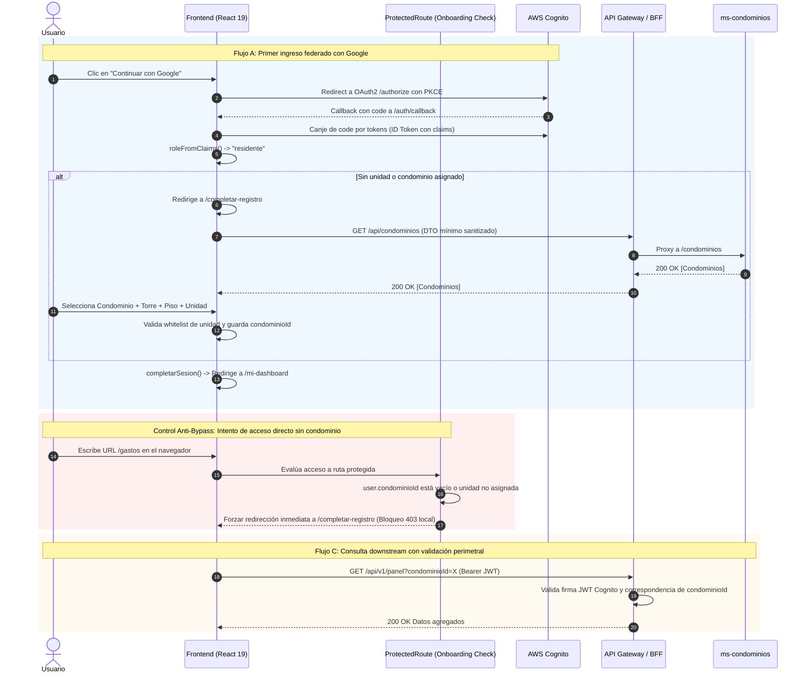

# Especificación de Diseño: Detección Automática de Rol JWT, Onboarding de Condominio y Eliminación de Selector Manual

**Fecha:** 2026-10-17  
**Estado:** Aprobado (Auditado para Seguridad)  
**Alcance:** Frontend Residentes (`Frontend-CloudNative/`), BFF (`bff`), Integración AWS Cognito, Modelos de Dominio y Contratos de API.

---

## 1. Contexto y Propósito

En la fase inicial de prototipado de Convivo, el portal de residentes (`Frontend-CloudNative/`) incorporó un conmutador manual de roles (`RoleSwitcherDropdown` en `NavHeader.tsx`) para alternar libremente entre `residente`, `conserje`, `admin` y `comite`. 

Con la infraestructura de autenticación desplegada en AWS Cognito (User Pool con login federado Google y flujo PKCE), la identidad y el rol real del usuario provienen de los claims criptográficamente firmados del ID token (`roleFromClaims`). Asimismo, para soportar la arquitectura multi-condominio de la plataforma, cada usuario debe quedar inequívocamente vinculado a un condominio registrado en el sistema.

Este diseño define:
1. **Detección automática de rol** desde el JWT, eliminando la selección manual de roles de la barra de navegación.
2. **Selección obligatoria de condominio** en el momento del registro:
   - Registro manual (`/crear-cuenta`).
   - Onboarding tras primer login federado con Google (`/completar-registro`) si el usuario no tiene condominio ni unidad asignada.
3. **Manejo de errores resiliente**: Si el BFF o `ms-condominios` no responde al listar condominios, la interfaz entra en un estado bloqueante con opción de reintento explícito.
4. **Navegación y aterrizaje automático** según el rol hacia la pantalla correspondiente (`residente` a `/mi-dashboard`, `conserje`/`comite` a `/espacios`).
5. **Inyección dinámica de `condominioId`** en las consultas a microservicios downstream (`panelApi`, `gastosApi`).
6. **Hardening y Fronteras de Confianza:** Controles anti-BOLA/IDOR, protección de rutas contra bypass de onboarding, sanitización estricta de parámetros y delimitación de seguridad entre cliente y BFF.

---

## 2. Fronteras de Confianza y Modelo de Amenazas (Security Audit)

```
[ Navegador / Cliente No Confiable ]
  │
  ├─ JWT (Firma RSA validada únicamente por API Gateway y BFF)
  ├─ localStorage (Manipulable por el usuario -> NUNCA fuente de verdad de autorización)
  │
════════════════════════════════════════════════════════════════════════════════
[ FRONTERA DE CONFIANZA: API Gateway / BFF ]
════════════════════════════════════════════════════════════════════════════════
  │
  ├─ Valida firma criptográfica y expiración del JWT (Cognito JWKS)
  ├─ Aislamiento Multi-tenancy: Valida que condominioId pertenezca al usuario (Anti-BOLA)
  ├─ Sanitización perimetral de query parameters y headers
  ▼
[ Microservicios de Dominio: ms-espacios-comunes / ms-gastos-comunes / ms-condominios ]
```

### 2.1 Amenazas Identificadas y Controles

| ID Amenaza | Vector de Ataque | Impacto Potencial | Control Defensivo Aplicado |
|---|---|---|---|
| **THR-01: BOLA / IDOR en `condominioId`** | El usuario altera `condominioId` en `localStorage` o manipula los query params de red para ver finanzas de otro condominio. | Fuga de datos financieros, reservas y residentes entre condominios (Cross-Tenant Leakage). | **Doble validación:** El frontend envía `condominioId`, pero el BFF y API Gateway contrastan el parámetro contra el claim de pertenencia del token. En el frontend, `getCondominioIdActual()` es de solo lectura y se codifica con `encodeURIComponent`. |
| **THR-02: Bypass de Onboarding** | Usuario con Google OAuth salta `/completar-registro` escribiendo manualmente `/mi-dashboard` o `/gastos` en el navegador. | Navegación con estado corrupto (`condominioId=undefined`), disparando errores 500 en Spring Boot que abren el circuit breaker del BFF. | **Guarda perimetral en `ProtectedRoute.tsx`:** Valida `hasCompletedOnboarding(user)`. Si falta `condominioId` o unidad, bloquea la ruta y redirige forzosamente a `/completar-registro`. |
| **THR-03: Fuga de Datos en Directorio Público** | El endpoint `GET /api/condominios` consumido por `/crear-cuenta` expone campos de administración o bancarios. | Divulgación de información sensible (RUT de administración, cuentas corrientes). | **Contrato DTO Mínimo:** La interfaz `CondominioItem` solo acepta `{ id, nombre, direccion }`. El BFF y microservicio excluyen explícitamente atributos administrativos. |
| **THR-04: Inyección en Campos de Unidad** | Inyección de caracteres especiales o saltos de línea en campos Torre, Piso o Número. | Inyección de parámetros o reflejo XSS en vistas de conserjería o reportes. | **Validación estricta con Whitelist:** Regex alfanumérica estricta en `validateUnit` (`^[a-zA-Z0-9\s\-°]+$`) y longitud máxima de 20 caracteres por campo. |
| **THR-05: Suplantación de Rol en Cliente** | Usuario altera el objeto `User` en `localStorage` fijando `role: "admin"`. | Escalación de privilegios cosmética en el frontend. | **Frontera de autorización en backend:** El frontend solo ajusta la interfaz gráfica. Toda petición protegida al BFF lleva el Bearer JWT real. Si el token no tiene el claim de Cognito, el backend responde `403 Forbidden`. |

---

## 3. Detección de Rol y JWT

### 3.1 Decodificación y Extracción de Claims
En `src/auth/cognitoAuth.ts`, el método `roleFromClaims` extrae el rol de los claims del ID token emitido por Cognito:

```typescript
export interface CognitoIdTokenClaims {
  sub: string;
  email?: string;
  name?: string;
  given_name?: string;
  picture?: string;
  "custom:unidad"?: string;
  "custom:torre"?: string;
  "custom:piso"?: string;
  "custom:condominio_id"?: string;
  "custom:terminos_version"?: string;
  "cognito:groups"?: string[];
  [key: string]: unknown;
}

export function roleFromClaims(claims: CognitoIdTokenClaims): Role {
  const groups = claims["cognito:groups"] ?? [];
  const match = groups
    .map((g) => g.toLowerCase())
    .find((g) => (VALID_ROLES as readonly string[]).includes(g));
  return (match as Role) ?? "residente";
}
```

### 3.2 Extensión del Modelo `User` (`src/types/index.ts`)
```typescript
export type Role = "residente" | "conserje" | "admin" | "comite";

export interface User {
  nombre: string;
  unidad: string;
  role: Role;
  avatar?: string;
  condominioId?: string;
  condominioNombre?: string;
}

export interface CondominioItem {
  id: string | number;
  nombre: string;
  direccion?: string;
}
```

---

## 4. Selección de Condominio al Registrarse

La asignación de condominio ocurre estrictamente durante el registro de la persona:

### 4.1 Flujo A: Registro Manual (`/crear-cuenta`)
1. En el **Paso 1** (`StepUnit` en `src/components/registro/StepComponents.tsx`), se añade un selector de Condominio como primer campo obligatorio.
2. Al montar el componente, se invoca `obtenerCondominios()` (`GET /api/condominios` a través del BFF).
3. Si la llamada es exitosa, el usuario selecciona:
   - Condominio (dropdown con los condominios registrados).
   - Torre (select: Torre A, Torre B, Torre C).
   - Piso (select: 1° a 12°).
   - Número de unidad (input: ej. 1204, validado por regex).
4. `validateUnit` comprueba que `condominioId` no esté vacío y sanitiza los valores. Sin condominio seleccionado, no se puede avanzar al Paso 2 (Datos de cuenta).

### 4.2 Flujo B: Primer Login con Google OAuth (`/completar-registro`)
1. El usuario hace login con Google vía Cognito Hosted UI.
2. En `src/pages/AuthCallback.tsx`:
   - Se canjea el `code` por tokens y se decodifican los claims.
   - Si no ha aceptado términos vigentes (`!aceptoTerminosVigentes(claims)`), redirige a `/aceptar-terminos`.
   - Si el usuario carece de unidad o condominio (`claims["custom:unidad"]` no existe o `claims["custom:condominio_id"]` está ausente), `AuthCallback` redirige a `/completar-registro` transfiriendo `{ tokens, usuario }` en el estado de navegación.
3. La página `/completar-registro`:
   - Carga la lista de condominios vía `obtenerCondominios()`.
   - Solicita: Condominio, Torre, Piso y Número de unidad con validación estricta de formato.
   - Al confirmar, actualiza el objeto `User` con la unidad compuesta y el `condominioId`.
   - Ejecuta `completarSesion(tokens, usuarioActualizado, setUser, navigate)` y redirige automáticamente a la vista del rol (`/mi-dashboard`).

---

## 5. Resiliencia y Manejo de Errores en `condominiosApi`

El frontend consume el endpoint del BFF `/api/condominios` (proxificado hacia `ms-condominios` en el puerto 8084):

```typescript
// src/services/condominiosApi.ts
import { API_ROOT } from "../api/client";
import type { CondominioItem } from "../types";

export async function obtenerCondominios(): Promise<CondominioItem[]> {
  const respuesta = await fetch(`${API_ROOT}/api/condominios`, {
    headers: { Accept: "application/json" },
  });

  if (!respuesta.ok) {
    throw new Error(`Error al cargar condominios (HTTP ${respuesta.status})`);
  }

  const datos = await respuesta.json();
  return Array.isArray(datos) ? datos : datos.items ?? [];
}
```

### Comportamiento ante fallos
Si el microservicio no está disponible o la petición falla por timeout de red:
- La UI entra en un **estado de error bloqueante**.
- Se despliega un mensaje claro: *"No pudimos cargar la lista de condominios disponibles. Verifica tu conexión o intenta nuevamente."*
- Se ofrece un botón **"Reintentar"** que vuelve a disparar `obtenerCondominios()`.
- **Regla estricta:** No se permite avanzar ni enviar el formulario con datos de condominio vacíos o ficticios.

---

## 6. Aterrizaje y Enrutamiento Automático por Rol

### 6.1 Función Central de Enrutamiento (`src/auth/sesion.ts`)
```typescript
export function rutaPrincipalPorRol(role: Role): string {
  switch (role) {
    case "residente":
      return "/mi-dashboard";
    case "conserje":
    case "comite":
      return "/espacios";
    case "admin":
      return "/dashboard";
    default:
      return "/";
  }
}
```

### 6.2 Protección de Rutas con Guarda de Onboarding (`ProtectedRoute.tsx`)
```typescript
export default function ProtectedRoute({ allowedRoles, redirectTo = "/" }: ProtectedRouteProps) {
  const { role, user } = useAuth();
  
  // 1. Validar autenticación y rol
  if (!role || !allowedRoles.includes(role)) {
    return <Navigate to={redirectTo} replace />;
  }

  // 2. Control Anti-Bypass: verificar onboarding completo para residentes
  if (role === "residente" && (!user?.condominioId || !user?.unidad || user.unidad === "Sin unidad asignada")) {
    return <Navigate to="/completar-registro" replace />;
  }

  return <Outlet />;
}
```

### 6.3 Redirección en Sesión Activa
- **En `completarSesion`**: La navegación post-login utiliza `navigate(rutaPrincipalPorRol(usuario.role), { replace: true })`.
- **En `Login.tsx` y `Home.tsx`**: Si `user` ya existe en el `AuthContext` y su perfil está completo, redirige a `rutaPrincipalPorRol(user.role)`, evitando que un usuario logueado permanezca en la pantalla de bienvenida o login.

---

## 7. Limpieza Arquitectónica: Eliminación de `RoleSwitcherDropdown`

Se elimina de raíz la posibilidad de conmutar roles en el cliente:
1. **`src/components/layout/NavHeader.tsx`**:
   - Se elimina la función y componente `RoleSwitcherDropdown`.
   - Se elimina el estado `roleSwitcherOpen`.
   - Se elimina la propiedad `setRole` de la interfaz `NavHeaderProps`.
2. **`src/components/Layout.tsx`**:
   - Se remueve `setRole` del hook `useAuth()` al instanciar `NavHeader`.
3. **`src/context/AuthProvider.tsx`**:
   - `setRole` se conserva únicamente para utilitarios internos de tests controlados, sin exposición directa en los controles visuales.

---

## 8. Inyección Dinámica y Sanitización de `condominioId` en Servicios

Para evitar dependencias estáticas de variables de entorno (`VITE_CONDOMINIO_ID="1"`), los servicios de datos leen el condominio activo del usuario autenticado sanitizando la entrada:

```typescript
// Helper en src/utils/authStorage.ts
export function getCondominioIdActual(): string {
  const usuario = getStoredUser();
  const idRaw = (
    usuario?.condominioId ||
    (typeof import.meta !== "undefined" && import.meta.env?.VITE_CONDOMINIO_ID) ||
    "1"
  );
  // Sanitización de parámetro para evitar query injection o caracteres corruptos
  return encodeURIComponent(String(idRaw).trim());
}
```

Este helper se aplica en:
- `src/services/gastosApi.ts`: Construcción de URL para gastos comunes (`condominioId=${getCondominioIdActual()}`).
- `src/services/panelApi.ts`: Query param `condominioId` para el resumen del panel.

---

## 9. Diagrama de Secuencia con Fronteras de Seguridad



---

## 10. Matriz de Pruebas y Criterios de Aceptación (Auditoría de Seguridad)

| ID | Categoría | Escenario | Resultado Esperado |
|---|---|---|---|
| TC-01 | **Auth & UI** | Usuario con token de residente inicia sesión | Redirige automáticamente a `/mi-dashboard` sin selector de roles visible |
| TC-02 | **Validación** | Usuario en `/crear-cuenta` sin seleccionar condominio | Botón siguiente bloqueado; validación muestra error requerido en pantalla |
| TC-03 | **Resiliencia** | Fallo de red (500/timeout) en `GET /api/condominios` | Vista de error bloqueante con botón "Reintentar"; no permite avanzar con datos vacíos |
| TC-04 | **Onboarding** | Primer login con Google sin atributos de unidad | Redirige a `/completar-registro` antes de dar acceso al dashboard |
| TC-05 | **Anti-Bypass** | Usuario sin onboarding intenta entrar directo a `/gastos` | `ProtectedRoute` intercepta y redirige a `/completar-registro` |
| TC-06 | **Sanitización** | Inputs de unidad con caracteres especiales maliciosos | Whitelist rechaza la entrada y previene inyecciones |
| TC-07 | **Integridad UI** | Barra de navegación en resoluciones desktop y mobile | `RoleSwitcherDropdown` no existe en el DOM en ningún entorno |
| TC-08 | **Enrutamiento** | Usuario con sesión activa navega a `/login` o `/` | Redirección inmediata a la vista correspondiente a su rol |
| TC-09 | **Multi-Tenancy** | Peticiones a `panelApi` y `gastosApi` | Envía `encodeURIComponent(condominioId)` persistido en la sesión del usuario |
| TC-10 | **Anti-Tampering** | Usuario altera manualmente `user.role` en localStorage a `admin` | Backend BFF responde 403 Forbidden al validar la firma del token real |
